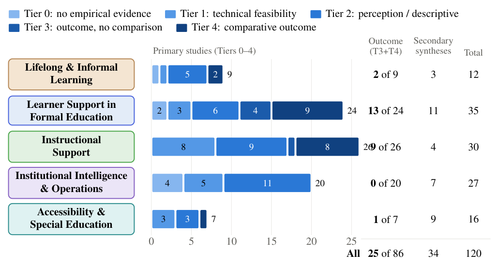

<h1 align="center">Evidence maturity in LLM-in-education research</h1>
<p align="center"><em>Reproducibility materials for the review "Large Language Models in Education: Applications, Evidence Maturity, and Governance"</em></p>

<p align="center">
  
</p>

<p align="center"><sub><strong>Evidence maturity of the 120 synthesized studies, by domain.</strong> Bars show each domain's primary studies on the five-tier scale
(Tier 0–4, one unit per study); the right-hand columns give primary studies with a measured outcome (Tier 3 or 4), secondary syntheses and domain totals.
Tiers order the <em>kind</em> of evidence, not its quality. Regenerated from <code>data/study_classifications.csv</code> by <code>scripts/make_figure.py</code>.</sub></p>

## Overview

A corpus of 150 records on LLM and AI applications in education was classified by the kind of evidence each study offers: from no empirical evidence
(Tier 0) through technical feasibility, perception or descriptive practice, and outcomes without comparison, to outcomes compared with an alternative
(Tier 4); literature syntheses are reported separately (S). 120 unique studies were synthesized in depth: **86 primary studies and 34 secondary
syntheses**, grouped into five domains. This repository releases the final classification and the code that recomputes every count the paper reports.
The method is summarized in [`CODEBOOK.md`](CODEBOOK.md); the rubric is [`RUBRIC_V3_1.md`](RUBRIC_V3_1.md).

## Key findings

*These describe this corpus, not the field: the search and screening procedure was not recorded, so the corpus is not a systematic sample.*

1. **Few studies measure an outcome.** Of the 86 primary studies, 25 (29.1%) measure a learning or practice outcome objectively, and 20 (23.3%) compare it with an alternative condition.
2. **Descriptive and feasibility evidence dominates.** Perception or descriptive practice is the most common tier (34 studies, 39.5%), followed by technical feasibility (20, 23.3%); 7 studies (8.1%) report no empirical evidence.
3. **Evidence is uneven across domains.** Primary studies with a measured outcome: learner support in formal education 13 of 24, instructional support 9 of 26, lifelong and informal learning 2 of 9, accessibility 1 of 7, institutional operations and governance **0 of 20**.
4. **Six subcategories contain no measured outcome:** Professional Upskilling, Teaching Practice & Rehearsal, Academic & Administrative Operations, AI Governance & Institutional Policy, Assistive Interfaces and Barrier Reduction.

## Results at a glance

| Domain | Studies | Primary | T0 | T1 | T2 | T3 | T4 | S | Measured outcome (T3+T4) |
|---|--:|--:|--:|--:|--:|--:|--:|--:|--:|
| D1 Lifelong & Informal Learning | 12 | 9 | 1 | 1 | 5 | 0 | 2 | 3 | 2 |
| D2 Learner Support in Formal Education | 35 | 24 | 2 | 3 | 6 | 4 | 9 | 11 | 13 |
| D3 Instructional Support | 30 | 26 | 0 | 8 | 9 | 1 | 8 | 4 | 9 |
| D4 Institutional Intelligence & Operations | 27 | 20 | 4 | 5 | 11 | 0 | 0 | 7 | 0 |
| D5 Accessibility & Special Education | 16 | 7 | 0 | 3 | 3 | 0 | 1 | 9 | 1 |
| **All domains** | **120** | **86** | **7** | **20** | **34** | **5** | **20** | **34** | **25** |

Tiers: T0 = no empirical evidence; T1 = technical feasibility; T2 = perception or descriptive practice; T3 = outcome, no comparison; T4 = comparative outcome; S = secondary synthesis.
The 14-subcategory version of this table is recomputed by `scripts/reproduce_all.py`.

## Reproduce

Python 3 with the standard library only (tested with 3.12.1); a LaTeX distribution with `tikz`, `standalone` and `newtx` is needed only for `--compile`.
Run from the repository root; all paths are relative.

```bash
python scripts/reproduce_all.py          # counts, tables, aggregate statistics -> expect: 42 passed, 0 failed, 3 not testable
python scripts/make_figure.py --compile  # regenerate the figure source (byte-identical check) and compile it
python scripts/check_package.py          # checksums and file hygiene -> expect: 6 passed, 0 failed
```

Each check prints `PASS`, `FAIL` or `NOT TESTABLE`; the scripts do not write into the repository.

| What | Status |
|---|---|
| Record-count reductions, tier counts, the two summary tables, percentages | **Exact**: recomputed from `data/` and compared with the values reported in the paper |
| Tier follows from design label | **Exact**: all 120 studies (see `CODEBOOK.md`) |
| Domain and subcategory assignment | **Exact** for all 150 records, given the taxonomy rules in `CODEBOOK.md` |
| κ, α, raw agreement, bootstrap interval | **Aggregate only**: recomputed from the aggregate agreement table, which is diagonal (all 22 pairs agree), so these values cannot show sensitivity to any disagreement |
| Field-level, topic-eligibility and decision-question agreement | **Not independently reproducible**: reported as supplied |
| The classifications themselves | **Not reproducible here**: released as final results; re-classification needs the source papers (not redistributed) and the rubric (`RUBRIC_V3_1.md`) |
| Validation sample draw | **Not reproducible**: frame, seed and sample list are not released; only the reported design is checked for consistency |
| Corpus assembly and the 15 set-aside records | **Not reproducible** (not recorded; reconstructed) |

## Method and validation in brief

* **Classification.** Each synthesized study was assigned a tier from its full text using a fixed decision sequence (rubric version 3; `RUBRIC_V3_1.md` adds two clarifications, on Q3/R11 precedence and the Tier 4 wording, and changes no decision). The initial classification was produced by an AI
  system working from the written instrument and the study documents. The authors checked it for allowed values and consistency with the decision rules, verified
  study identity against registry DOIs, and re-read only the studies whose topic eligibility had to be adjudicated and one study whose scanned text was re-processed.
  Outside the validation sample, classifications were **not independently re-coded**.
* **Validation.** A random sample of 30 studies (six per domain, from a frame of 99) was classified independently by a human coder who is a **co-author**, so this is
  not an arm's-length validation; the paper states that the coder had no access to the per-study initial classifications. Twenty-nine of the 30 were on topic and 22
  were primary studies on the 0–4 scale; the two classifications agreed on all 22 (linear-weighted κ = 1.00).
* **Plan.** The validation followed a pre-specified plan, fixed and time-stamped in a private project record before the sample was drawn. It was **not publicly
  registered**, so third parties cannot verify when it was fixed.
* **Interpretation.** This is agreement between the initial classification and independent human coding, **not human–human inter-rater reliability**. Unanimity across
  only 22 studies is consistent with considerably lower underlying agreement, and the bootstrap interval is degenerate [1.00, 1.00]. Agreement on some recorded fields was
  clearly lower than on tier (comparison 0.70, setting 0.67), so only tier, domain, subcategory and design label are released.
* **What the released tiers are.** Final classifications, not coder-specific scores. Raw individual codes, initial classifications, justifications and adjudication
  records are not released.

<details>
<summary><strong>Record counts</strong> (two separate reductions)</summary>

1. **150 records → 149 unique articles.** Two records are copies of the same published article (same title in the file metadata, same page count, and the pages compared render identically); one was counted once.
2. **150 records → 121 synthesized records → 120 unique studies.** 29 records are not part of the synthesis. Because two of the 121 are the same article, they represent 120 unique studies (86 primary, 34 secondary syntheses). Equivalently, 149 unique articles minus the 29 non-synthesized = 120.

| Non-synthesized records | Reason | Basis (`exclusion_basis`) |
|---|---|---|
| 15 | General-purpose AI or systems papers outside the educational-relevance criterion | **Post-hoc reconstruction**: which records were left out was not logged when the corpus was assembled; the review's criterion was applied afterwards. Not a contemporaneous screening record |
| 3 | Source file could not be read | Verifiable file property |
| 9 | Excluded by the topic-eligibility question (3 study no AI-enabled system; 6 study AI outside education) | Decision recorded at classification |
| 2 | Excluded at a corpus-integrity check | Decision recorded by the authors |

</details>

## Known limitations

* **Domain 4 subcategories.** The 47 Domain 4 records split 38 *Academic & Administrative Operations* / 9 *AI Governance & Institutional Policy* (the taxonomy's
  explicit nine-record Governance list; every other Domain 4 record, including the 16 set aside at corpus construction, is Operations by default). Of the 31 records
  synthesized before the topic-eligibility and integrity exclusions, 22 are Operations and 9 Governance; the 27 unique final studies split 20 and 7. These are different
  counting units and are checked separately. One record (a review of telecommunications and AI infrastructure for education) was placed in Operations because its main
  subject is the infrastructure and applications that enable AI-supported education, with ethics and governance as one section of it. That is a classification judgement:
  placing it in Governance instead would change the record split to 37 / 10 and the final-study split to 19 / 8.
* **Domain reclassification.** After peer review, a co-author coded the domain of a stratified random sample of 30 primary studies without the original labels. Disagreements were resolved against the written domain definitions and the source texts, and 13 studies were reclassified; a later check of the outcome studies against their sources moved one more. `data/domain_reclassification.csv` lists all 14 with their original and revised labels. The agreement statistics of that check refer to the original labels and are reported in the paper.
* **Search not recorded.** The corpus is not a systematic sample and its assembly cannot be reproduced.
* **One classifier for most studies.** Outside the 29 validated studies, classifications come from the AI classification plus the checks above, not from a second coder.
  The AI classification ran in fresh sessions instructed to use only the coding bundle; isolation was instructed and checked afterwards, not enforced technically.
* **Scanned sources.** Twenty-nine of the 120 studies were classified from text recovered by optical character recognition and one from a verified replacement copy; such classifications carry capped confidence.
* **Bibliographic gaps.** Three of the 120 studies have no DOI in the source bibliography; nothing was inferred.

<details>
<summary><strong>Repository layout</strong></summary>

| File | Purpose |
|---|---|
| `RUBRIC_V3_1.md` | The evidence-classification rubric |
| `CODEBOOK.md` | Classification method: decision sequence, tiers, design labels, interpretive rules, domains |
| `DATA_DICTIONARY.md` | Every column of every data file, and how the files were produced |
| `DATA_AVAILABILITY.md` | What is and is not released, and why; the statement for the paper |
| `data/domain_reclassification.csv` | The 14 studies reclassified after peer review: original and revised domain and subcategory, and the rule applied |
| `data/corpus_records.csv` | The 150 records: manifest category, review domain, status, exclusion category and its basis |
| `data/study_classifications.csv` | Final classification (domain, subcategory, tier, design label) of the 120 studies |
| `data/study_metadata.csv` | Title, year, venue and DOI of each of the 120 studies |
| `validation/aggregate_results.json` | Aggregate agreement statistics (no study-level data) |
| `results/reported_results.json` | The numbers as reported in the paper, used as expected values |
| `figures/` | Source (`.tex`) and PNG of the figure above |
| `scripts/` | `reproduce_all.py`, `make_figure.py`, `check_package.py` |
| `SHA256SUMS.txt` | Checksums of every file |

</details>

## Not included

The paper's manuscript source and bibliography; the reviewed papers and any text derived from them; titles and metadata of non-synthesized records; the validation sampling
frame, seed and sample list; the coders' study-level codes, confidence ratings, deciding questions and free-text justifications; adjudication records; coding bundles, prompts and
working notes; internal reports and logs. See [`DATA_AVAILABILITY.md`](DATA_AVAILABILITY.md).

## Citation and licence

Repository: https://github.com/ahsan-h-shihab/llm-in-education. No licence has been selected: default copyright applies and no reuse rights are granted.
